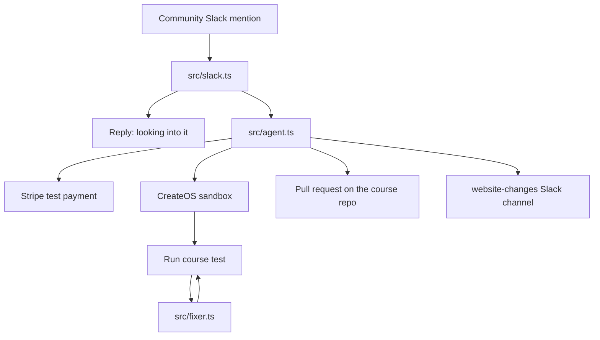

# Slack Agent

A Slack bot for a community. When someone posts that they paid and the product still shows unpaid, the bot looks up the payment, recreates the website code in a sandbox, fixes the bug, and opens a pull request.

The demo product is a small course site. Two students are on the roster. A paid fee is written onto the wrong student. The sandbox test catches that, the agent corrects the match, and GitHub receives the fix.

testing demo website - https://github.com/chaitralikakde/testing-workflow

## What it does

1. A person mentions the bot in Slack. The message has to say they paid and that the status is still unpaid.
2. The bot replies in that thread: "We're looking into this and will update you soon."
3. The bot asks Stripe, in test mode, for the course payment. It reuses a succeeded $49 payment for Maya, or creates that test payment if it is missing.
4. The bot starts a CreateOS sandbox on the free plan (`s-1vcpu-1gb`, `devbox:1`).
5. It uploads the course page, the test, and the payment record into the sandbox.
6. It runs the test and reads the output and the exit code.
7. If the test says the payment landed on the wrong student, the bot changes the email check in the course code and runs the test again. It stops after a pass, or after 4 tries.
8. The sandbox is deleted.
9. The fixed `site/course.mjs` is committed on branch `fix/wrong-student` and opened as a pull request on `GITHUB_REPOSITORY`.
10. The bot posts in the website-changes channel: "Found 1 bug.", the pull request link, the Stripe test payment id, and the Stripe project name.

A mention that does not describe a paid-but-unpaid problem gets a short reply asking for that wording. The fix does not run.

## Architecture



| Piece | Role |
| --- | --- |
| Slack listener | Socket Mode. Hears `app_mention`, replies in the thread, and posts the result in the changes channel. |
| Agent | Owns the loop: payment, sandbox, test, fix, destroy, pull request. |
| Stripe CLI | Reads or creates Maya's test payment, then returns the CLI to live mode. No live charge is created. |
| CreateOS sandbox | Runs the course test away from this machine. The free plan allows one sandbox at a time. |
| Fixer | Reads the test output. When Maya is unpaid and Ava is paid, it matches the checkout email to Maya's row. |
| GitHub | Updates `site/course.mjs` on `fix/wrong-student` and opens the pull request. |
| Course site | The buggy product. Local preview only. The agent does not edit the copy that is already on `main` until the pull request is merged. |

Stripe Projects provisioned the CreateOS free plan and the CreateOS project. Those credentials live in `.env` as `CREATEOS_PROJECT_API_KEY` and `CREATEOS_PROJECT_API_URL`. The sandbox client accepts `CREATEOS_SANDBOX_API_KEY` first, then the project key.

## Folder structure

```text
.
├── site/
│   ├── course.mjs         Course page and the roster bug
│   ├── course.test.mjs    Fails while the fee updates the wrong student
│   ├── server.mjs         Local preview of the course page
│   └── payment.json       Generated payment record, not committed
├── src/
│   ├── slack.ts           Slack Socket Mode listener
│   ├── mention.ts         Decides whether a message is an unpaid report
│   ├── messages.ts        Community reply and website-changes post
│   ├── agent.ts           Sandbox loop until the test exits 0
│   ├── fixer.ts           Applies the one-line roster fix
│   ├── github.ts          Opens the pull request
│   ├── stripe-payment.ts  Reads or creates the test payment
│   ├── stripe-project.ts  One status line from Stripe Projects
│   ├── run.ts             Runs the agent without Slack
│   └── fixer.test.ts      Tests the mention, messages, and fixer
├── .projects/
│   ├── state.json         Project record for Stripe Projects
│   └── state.local.json   Local project identity for the submission
├── env.sample             Key names only
├── package.json
└── README.md
```

`.env`, `node_modules`, `.projects/vault`, and `site/payment.json` stay off git.

## The bug in the course site

- testing demo website - https://github.com/chaitralikakde/testing-workflow

`site/course.mjs` keeps two students, Maya and Ava, both unpaid. When a completed checkout arrives, `applyPayment` selects the student whose email is **not** the payer:

```javascript
const row = students.find((student) => student.email !== checkout.email);
```

Maya's fee is written onto Ava. Ava's id is replaced with Maya's id. Maya stays unpaid.

The sandbox test expects Maya paid with id `stu_maya`, and Ava unpaid with id `stu_ava`. The failure text is `payment wrote the wrong row: Maya=unpaid, Ava=paid`. The fixer replaces `!==` with `===`, so only Maya's row changes. The same test is uploaded again and must exit 0.

## How to use it

You need Node.js 20 or newer, the Stripe CLI with the Projects plugin, a Slack app in Socket Mode, and a GitHub personal access token that can open pull requests on the course repo.

### 1. Install

```bash
npm install
```

### 2. Environment

Copy `env.sample` to `.env` and fill the values. Do not commit `.env`.

| Name | Used for |
| --- | --- |
| `CREATEOS_PROJECT_API_KEY` | Sandbox API key written by Stripe Projects |
| `CREATEOS_SANDBOX_API_KEY` | Optional override of the project key |
| `CREATEOS_SANDBOX_BASE_URL` | Sandbox API. Default `https://api.sb.createos.sh` |
| `SLACK_BOT_TOKEN` | Bot token (`xoxb-`) |
| `SLACK_APP_TOKEN` | App-level token (`xapp-`) with `connections:write` |
| `GITHUB_TOKEN` | Token that can write to the course repository |
| `GITHUB_REPOSITORY` | Course repo as `owner/name`, the repo that receives the pull request |

`GITHUB_REPOSITORY` is the website repo, not this agent repo. This agent repo holds the bot. The pull request updates the course site in the other repo.

Stripe Projects fills the CreateOS keys:

```bash
stripe projects env --pull
```

Leave `STRIPE_API_KEY` unset. The payment step uses the Stripe CLI session. It switches that session to test mode for the payment, then switches it back to live mode.

The Slack app needs the bot scopes `app_mentions:read`, `chat:write`, and `chat:write.public`. Subscribe to the `app_mention` event, turn on Socket Mode, and invite the bot to the community channel and to the website-changes channel (`C0CA552P1C1` in `src/messages.ts`).

### 3. Preview the buggy site

```bash
npm run site
```

Open http://localhost:3000. The page says Maya's fee was received. The roster shows Maya unpaid and Ava paid.

### 4. Run the unit checks

```bash
npm test
```

These checks stay on this machine. They cover the Slack sentence, the two channel messages, and the roster rewrite. They do not start a sandbox.

### 5. Run the agent once

```bash
npm run fix
```

This is the full loop without Slack: test payment, sandbox, fix, delete sandbox, pull request. The last lines are the message that would be posted in website-changes. The process exits when that message is printed.

### 6. Listen in Slack

```bash
npm run slack
```

Leave this process running. Slack does not replay a mention that arrived while the process was stopped.

In the community channel, mention the bot with both words, for example:

```text
@bot i paid the fees but still seeing unpaid status
```

The thread gets the "looking into it" reply. The website-changes channel gets "Found 1 bug." and the pull request link. If the sandbox or GitHub step throws, the error is posted back in the community thread.

## Sandbox limits

The CreateOS service on this project is the free plan.

- One sandbox at a time. A paused sandbox still counts.
- Shape `s-1vcpu-1gb` and rootfs `devbox:1`.
- The agent deletes the sandbox in a `finally` block, including when the test fails.

`npm run fix` and `npm run slack` both create that sandbox. Run one of them at a time.

## Pull request

`src/github.ts` writes only `site/course.mjs` on branch `fix/wrong-student`. The commit message is "Apply Maya's payment to Maya's roster row". If that branch already exists, the file is updated on it. A second pull request for the same branch fails while the first one is still open.
